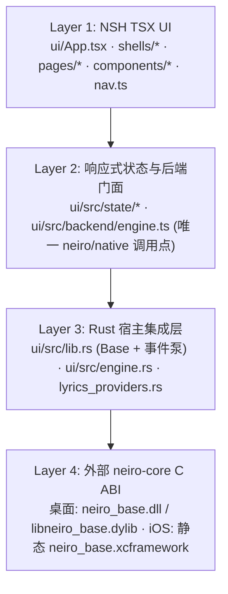

# Neiro UI 架构与模块边界

本文件描述 `neiro` 独立客户端宿主的分层架构、目录职责、单所有者状态表与导航模型。

---

## 1. 四层架构

- **绝对边界**：`neiro` 仓库**不编译 C++ 引擎**，也不包含本地子模块；所有音频解码、输出设备、EQ/DSP 与底层曲库均通过 `neiro-core` 发布的 C ABI 调用。

---

## 2. 目录与文件职责

| 路径 | 职责 |
|---|---|
| `ui/App.tsx` | 应用根组件：布局门控（`layout()`）、全局壳层挂载、互斥弹窗/抽屉、快捷键与 `Toaster` |
| `ui/src/shells/` | 可热插拔界面外壳：`desktop.tsx`（经典工业机架工作台）、`studio-minimal.tsx`（极简黑胶母带台）、`main.tsx`（共享 `MainStack`） |
| `ui/src/nav.ts` | 多根独立栈导航：每个根路由保持独立 `NavStack` 与滚动记忆，支持前进/后退 |
| `ui/src/pages/` | 业务页面：`home.tsx`、`search.tsx`、`albums.tsx`、`artists.tsx`、`tracks.tsx`、`detail.tsx`、`remote.tsx`、`user-collections.tsx`、`eq.tsx`、`settings.tsx`、`engine-down.tsx` |
| `ui/src/components/` | 通用原语（`ui/*`）、布局与页壳（`layout.tsx`、`page.tsx`、`header.tsx`）、曲库组件（`library/*`）、播放器与调音台表面（`player/*`、`player/surface/*`） |
| `ui/src/state/` | 响应式信号（Signal）状态层，遵循**单所有者原则** |
| `ui/src/backend/engine.ts` | 唯一调用 `"neiro/native"` 的强类型单例门面（`Engine`），统一分发命令与订阅事件 |
| `ui/src/backend/types.ts` | 前后端共享的 TypeScript 类型定义与辅助函数 |
| `ui/src/lib.rs` | `#[nsh::export]` 暴露的 `Base` 类、异步事件泵（`pump`）、本地封面/远程缓存统计与清理 |
| `ui/src/engine.rs` | C ABI 加载与封装、参数规范化（`normalize_queue_items_json`）、`v0.2.0` `-2` 降级与生命周期管理 |
| `ui/src/lyrics_providers.rs` | 在线歌词多源检索的 Rust 实现（LRCLIB / 网易云 / QQ 音乐 / 酷狗） |
| `scripts/` | 预构建核心 SDK 拉取（`fetch-core.sh` / `fetch-core.ps1`）、打包与编码检查（`check-encoding.ps1`） |
| `.github/workflows/` | CI 构建门禁：`macos.yml`、`windows.yml` |

---

## 3. 单所有者状态注册表（Single-Owner State Registry）

每份核心状态在全工程中有且仅有一个权威所有者，禁止在组件或其它模块重新派生或维护第二份副本：

| 状态 / 能力 | 权威所有者 | 说明与约束 |
|---|---|---|
| Bit-Perfect 绿灯判定 | `isStreamBitPerfect()`（`ui/src/state/resolved.ts`） | 综合引擎 `renderPath().bitPerfect` 与宿主 DSP 状态；所有面板/徽章必须调用此函数 |
| 采样率格式化 | `formatHz`（`ui/src/state/resolved.ts`） | `formats.ts` 中的 `formatRate` 仅做重导出 |
| 输出策略（采样率/共享模式/抖动/DSD） | `applyPolicy()` & `restorePolicyAtStartup()`（`ui/src/state/resolved.ts`） | 负责持久化与引擎就绪后的策略恢复 |
| 播放状态与顺序（Shuffle / Repeat） | `player`、`shuffleMode`、`repeatMode`（`ui/src/state/player.ts`） | 与 `queueSnapshot` 事件实时同步并持久化；`state/shuffle.ts` 仅做重导出 |
| 本地曲库与根目录 | `ui/src/state/catalog.ts` | 根目录管理、分页加载、扫描状态与曲目索引 |
| 远程服务器花名册与激活来源 | `ui/src/state/sources.ts` & `ui/src/state/remote.ts` | 服务器配置、来源切换、`remote://` 流调度与目录分页 |
| 插件矩阵与当前外壳（Shell） | `ui/src/state/plugins.ts` | 插件启停、外部外壳注册表与 `activeShellId` |
| 全局互斥弹窗与抽屉 | `ui/src/state/overlays.ts` | 管理 Now Playing、Output 控制台、队列抽屉、插件/服务器对话框的互斥开关 |
| 60Hz FFT 频谱按需开关 | `visualiserWanted`（`ui/src/state/visualiser.ts`） | 仅在播放中且存在可见消费端时开启 |

---

## 4. 导航与外壳模型

- **多根保活栈（`ui/src/nav.ts`）**：`ROOT_ROUTES` 包含 `HOME`、`SEARCH`、`ALBUMS`、`ARTISTS`、`TRACKS`、`REMOTE`、`LIKED`、`PLAYLISTS`、`SETTINGS`。桌面端切换根栏目时仅切换可见栈而不销毁页面，配合 `rememberScroll(key)`（`ui/src/state/page-scroll.ts`）保留滚动位置。
- **共享内容区（`ui/src/shells/main.tsx`）**：无论当前激活的是 `DesktopShell`、`StudioMinimalShell` 还是外部注册的 UI 外壳，主内容路由均应挂载 `<MainStack />` 来渲染页面。
