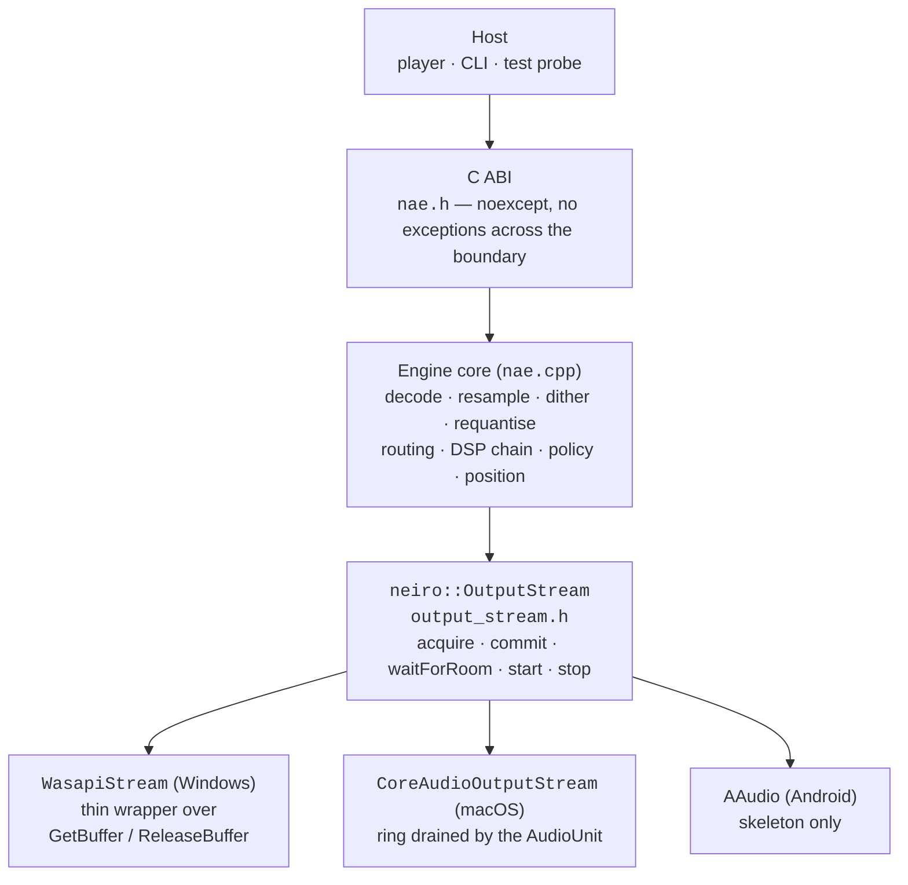
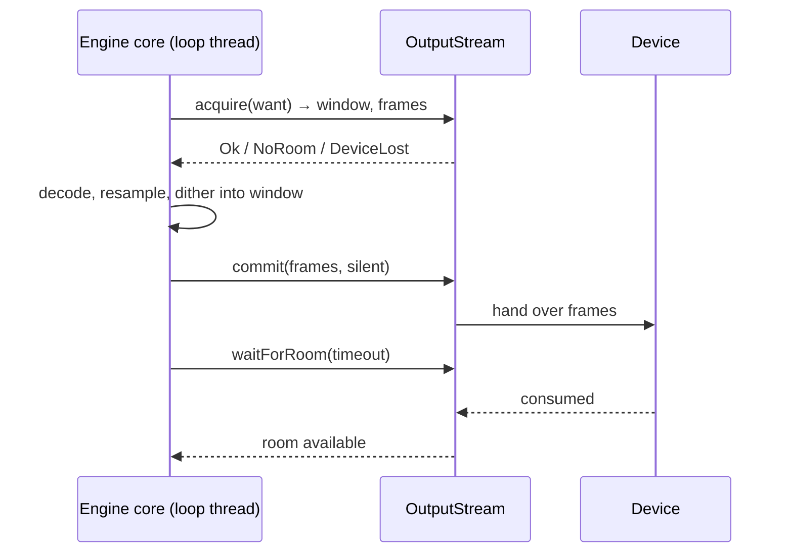

# Architecture

What calls what, and where the platform boundary is.

The engine core has no platform branches. Everything above `OutputStream` -- the
render loop, the fifo, the resampler, the dither, the counters a host reads -- is
the same code on every endpoint.

## Why the primitive is "room, window, commit"

WASAPI offers that shape directly: `GetBuffer` hands back a writable window,
`ReleaseBuffer` commits it. CoreAudio does not -- it calls *you* on its own
realtime thread. Presenting WASAPI's shape on both keeps one render loop rather
than one per platform, and a second loop would be a second copy of the DSP.

On macOS the `acquire`/`commit` pair writes into a ring that the AudioUnit
drains; the AudioUnit's callback does one `memcpy` and nothing else, because
decoding on a realtime thread is the fault this design exists to avoid.

## Where each platform's device knowledge lives

| Layer | Windows (WASAPI) | Windows (ASIO) | macOS | iOS | Android |
|---|---|---|---|---|---|
| caps: rates, formats, DoP | `nae.cpp` (WASAPI exclusive probe) | `backend_asio.cpp` (driver) | `backend_coreaudio.cpp` (HAL) | not written | not written |
| open / format negotiation | `nae.cpp` `openExclusiveImpl` | `nae.cpp` `openExclusiveImpl` + `backend_asio.cpp` | `backend_coreaudio.cpp` | not written | not written |
| stream primitive | `WasapiStream` | `AsioStream` + the ring in `backend_asio.cpp` | `output_stream_coreaudio.cpp` | not written | `backend_aaudio.cpp` (skeleton) |
| dither, resample, routing, position | shared | shared | shared | shared | shared |

The ASIO column exists because Windows has two device families, and they are told
apart by the device id alone: `asio:{CLSID}` is the ASIO driver registered under
`HKLM\SOFTWARE\ASIO`, and every other id is a WASAPI endpoint. Neither backend
knows about the other, and the render loop cannot tell which one it is driving --
which is what keeps the DSP and the position accounting a single copy.

## The C ABI is three copies of one list

`nae.def` (MinGW link input), `nae.map` (version script) and `ffi.rs` (Rust
declarations) describe the same export table. A symbol missing from all three
links inside the DLL and is simply absent from the export table, so the host
fails at load. Mach-O needs `-exported_symbols_list` instead of the first two.

## Status of the port

| Endpoint | Engine builds | Engine tested |
|---|---|---|
| Windows | yes | yes — `nae_test`, `mode_check`, `decode_check`, and the audio-path checks |
| macOS | yes | yes — `macos_play_check`, `output_stream_check`, `hog_mode_check`, and `base_probe` end to end (10 consecutive runs) |
| iOS | no | no — needs AVAudioSession + RemoteIO, and the HAL backend there does not compile |
| Android | no | no |

Details: `engine/PORT-HANDOVER.md` (state, fixed defects, platform facts). The
macOS port is complete except for bit depth, which needs a DAC that advertises an
integer stream format to verify.
