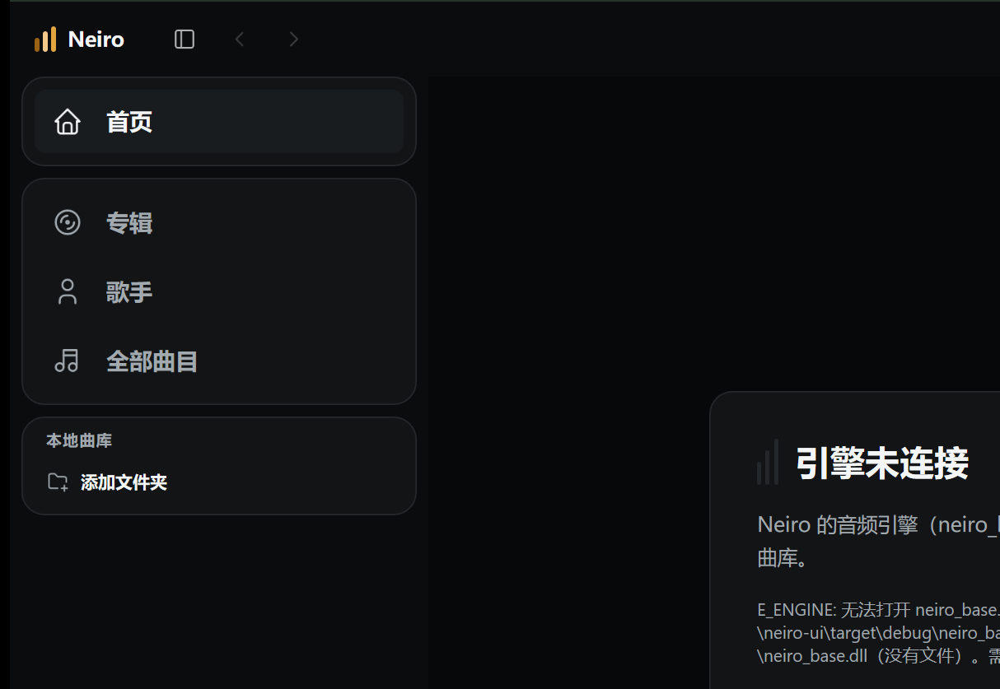

# Neiro UI

Neiro 音频引擎的桌面播放界面，用 [Native Shell](https://nsh.dev)（NSH）绘制：
TSX 界面 + 一个薄 Rust 转接层，通过 Base 的 C ABI 驱动本机曲库——本地文件，
无账号、无登录、无流服务。

界面设计借鉴 [huacnlee/spotish](https://github.com/huacnlee/spotish)（NSH 的
Spotify 客户端）：暗色近黑单背景、三面板圆角侧栏、浮动播放条、全屏 Now Playing、
曲目表与卡片网格、列表入场波与 selection 滑动。区别在数据源与几个刻意留下的
空白（见下）。



## 构建与运行

前置：`nsh` CLI（nightly，与 `Cargo.toml` 锁定的 `nsh-core` 同一提交）、Rust。

```sh
nsh check        # cargo check + tsc
nsh run          # 构建并在窗口运行
nsh test         # Rust 测试 + TSX 无头测试
```

没有引擎也能跑：窗口显示"引擎未连接"，界面其余部分照常。真实播放需要 Base：

1. 构建 engine（C++）：`cd ../Neiro/engine && cmake --preset windows &&
   cmake --build --preset windows`（需要 MinGW 在 PATH 最前，且 LGPL 的 FFmpeg，
   见 `../Neiro` 的说明）。
2. 构建 base：`cd ../Neiro/base && RUSTUP_TOOLCHAIN=<MSVC 工具链> cargo build --release`
   （默认 MSVC 会把 `link.exe` 解析到 GNU coreutils 的 `link`）。
3. 回到本仓库点窗口里的"重试"，或 `NEIRO_BASE_DLL=<路径>` 直接指向构建产物。

细节、协议语义与陷阱见 [HANDOVER.md](HANDOVER.md)。

## 结构

| 层 | 文件 | 职责 |
|---|---|---|
| Rust 转接层 | `src/engine.rs` | 打开 `neiro_base.dll`，序列化命令/事件（tag snake_case） |
| Rust 转接层 | `src/lib.rs` | `Base` 类：事件泵、TSX 表面（`onXxx` + 命令） |
| 后端 | `src/backend/engine.ts` | 唯一调用 `"neiro/native"` 的文件；单例 + 信号镜像 |
| 状态 | `src/state/*` | player（乐观控制 + position 推进）、catalog（根目录/懒加载/搜索）、artwork（LRU data URL）等 |
| 组件 | `src/components/*` | ui 原语、侧栏、播放条/Now Playing/输出抽屉 |
| 页面 | `src/pages/*` | 首页/搜索/专辑/歌手/全部曲目/详情/引擎未连接 |
| 外壳 | `src/shells/*`、`src/nav.ts` | 桌面布局（侧栏 + 页栈 + 浮置播放条）、页栈 |

## 刻意留下的空白

这些不是没做完，是范围决定或协议事实：

- **无 liked 心形、播放列表**：Base 有接口（`set_favourite`、playlists），呈现方式
  待定后接上。
- **"上一曲"不可用**：Base 协议只有 `next` 方向；播过的曲目按事实禁用。
- **未报即未知**：Base 没报的 title/时长/音量显示 `—`/禁用，绝不发明默认值
  （引擎仓库 `AGENTS.md` 规则 1）。
- **没有音乐光束**：spotish 的封面取色管线属于"Base 功能后续接"那批。
- **只做桌面 shell**：phone/TUI 后续。

## 许可

仅限内部使用。Spotify 与 spotish 各自的许可不适用本仓库；NSH 属其作者。
